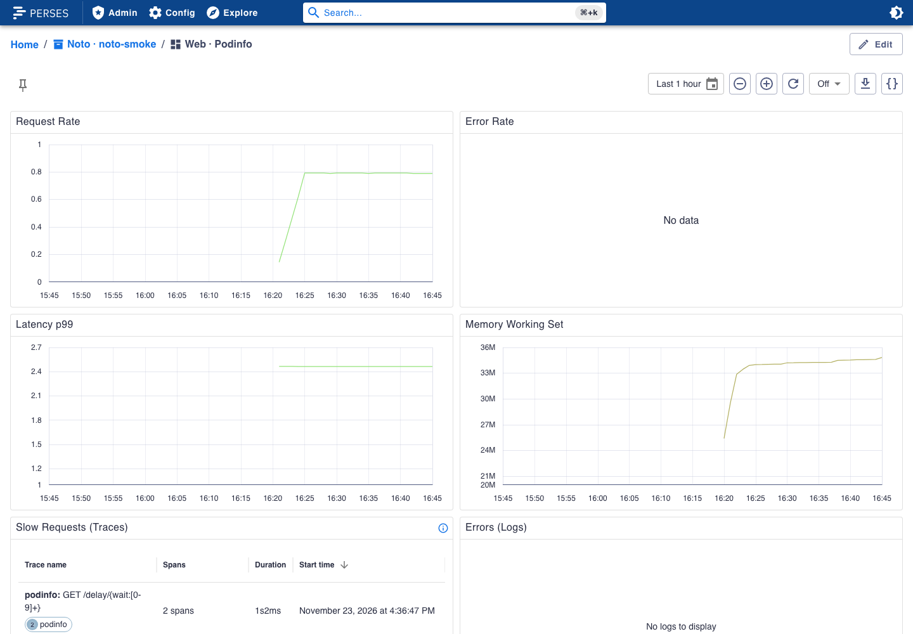

# Noto

Noto stands up an open-source observability platform on a cluster and wires each deployed app into it by its workload class.

[](https://github.com/tenishai/noto/actions/workflows/ci.yml)
[](https://github.com/tenishai/noto/releases)
[](LICENSE)
[](#status)



## Overview

Noto makes what [gojira](https://github.com/tenishai/gojira) deploys observable. Where
gojira gets your app running on Kubernetes, noto continues the same lifecycle: it installs
the metrics, logs and traces backends and the OpenTelemetry collection tier once per
cluster, then gives each app a dashboard, alerts and an SLO derived from the workload class
gojira already assigned. No hand-rolled collector YAML and no vendor backend.

- **Automatic.** Once the platform is up and gojira's observe step is on, a deployment is
  observed with no per-app configuration.
- **Opinionated.** A workload's class selects how it is observed; the collector pipelines
  are a default, not a blank file.
- **Open source, end to end.** OpenTelemetry, Mimir, Loki, Tempo, Perses and Alertmanager.
- **Driven from a CLI.** An agent or a person runs the same commands; there is no web UI
  of noto's own.
- **Reads gojira's contract.** The deploy contract is the source of truth; noto does not
  keep a second copy.

Noto is the observability member of the tenish family of open-source platform and agent
projects: [gojira](https://github.com/tenishai/gojira) deploys,
[kobo](https://github.com/tenishai/kobo) is where people build agents,
[sero](https://github.com/tenishai/sero) keeps secrets, [bab](https://github.com/tenishai/bab)
decides what an agent may do, and [liminal](https://github.com/tenishai/liminal) is the
gateway agents reach tools through. gojira is the one integration noto ships today: it
reads gojira's deploy contract, and gojira runs `noto observe` as a Job after each deploy.

To run the whole suite on a cluster, start at [stack](https://github.com/tenishai/stack), which brings the other parts up from
one file in dependency order. Noto is installed on its own, as the Quickstart below shows.

## Quickstart

Render what noto would install for a sample app, with no cluster. The only prerequisite is
[uv](https://docs.astral.sh/uv/); it fetches Python 3.14 for you.

```
git clone https://github.com/tenishai/noto && cd noto
uv sync --frozen
uv run noto render --gojira tests/smoke/gojira.yaml --env dev
ls .noto/rendered-app
```

`render` reads a gojira deploy contract (the sample describes `podinfo`, a `web` class
app) and writes the four families noto derives from the class: `scrape.yaml` (collection),
`perses.yaml` (the dashboard), `alerts.yaml` (alert rules) and `slo.yaml` (the SLO). It
touches nothing else.

To see the whole thing run, `make smoke` creates a [kind](https://kind.sigs.k8s.io/)
cluster, installs the platform, deploys the sample app, observes it and checks the result;
the picture above is its dashboard. It needs Docker with at least four CPUs, kind, kubectl and helm, and about
fifteen minutes. `KEEP=1 make smoke` leaves the cluster up to look around.

## How it works

```
gojira:  repo ──▶ identity ──▶ CI/CD ──▶ manifests ──▶ app running, /metrics exposed
                                                              │
                                                              ▼  (noto continues)
noto:   per-cluster platform (collectors + backends + Perses) ──▶ wire each app by class ──▶ dashboards · SLOs · alerts
```

`noto platform --cluster <name> --env <dev|qa|prod>` stands the platform up once per
cluster. `noto observe --gojira <path> --env <env>` wires one app in. Both apply directly
through Helm, kubectl and OpenTelemetry Operator resources, with no GitOps controller in
the path.

| Layer | Tool |
|---|---|
| Collection | OpenTelemetry Collector (custom distribution): agent, gateway and target allocator |
| Metrics | Mimir |
| Logs | Loki |
| Traces | Tempo |
| Dashboards | Perses |
| Alerting | Alertmanager |
| Cluster sources | kube-state-metrics, node-exporter, kubelet and cAdvisor |

## Status

Alpha, and running in our own development cluster.

Working: the per-cluster platform; observing an app by class (collection, dashboard,
alerts, SLO); rules pushed to Mimir's ruler and routed through Alertmanager; `observe` as a
one-shot Job after a deploy; the integrations catalog and the cardinality report; released
images, checked before they publish.

Not yet: the Guard and Reason phases of the roadmap; an agent of noto's own; secrets
through [sero](https://github.com/tenishai/sero). The platform is built and run on
`linux/amd64`.

[ROADMAP.md](ROADMAP.md) is the phase plan and [CHANGELOG.md](CHANGELOG.md) is what has
shipped.

## Documentation

- [docs/operating.md](docs/operating.md): the platform record, retention, rules, endpoints, the observe Job, the image
- [docs/design.md](docs/design.md): architecture, decisions and the deployment order
- [docs/otel-collector-enablement-guide.md](docs/otel-collector-enablement-guide.md): the collector patterns noto ships as defaults
- [docs/observability-platform-design.md](docs/observability-platform-design.md): where the platform is heading
- [ARCHITECTURE.md](ARCHITECTURE.md) and [docs/arch/](docs/arch/): a map of the code, for people and coding agents
- [RELEASING.md](RELEASING.md), [docs/versioning.md](docs/versioning.md), [docs/versions.md](docs/versions.md): releases and pins
- [docs/testing.md](docs/testing.md): how we test
- [SECURITY.md](SECURITY.md): how to report a vulnerability

## Contributing

Issues and pull requests are welcome. [CONTRIBUTING.md](CONTRIBUTING.md) has the setup,
the checks CI runs and the sign-off every commit needs; the
[Code of Conduct](CODE_OF_CONDUCT.md) applies to everyone taking part.

## How this was built

tenishai is a small team of engineers who build with AI coding agents. Most of
this code was written in pairing sessions with Claude models in Claude Code: a
person set the design, directed the work and reviewed what landed, and the
agent wrote much of the code and docs. Many commits name the agent in a
`Co-Authored-By:` trailer, either a Claude model or the name of the
agent one of us pairs with. A commit without a trailer may still
have had AI help.

## License

[MIT](LICENSE), matching the tenishai family (gojira, techne, liminal, cabal, daedalus).

Copyright (C) 2026 tenish and the noto contributors