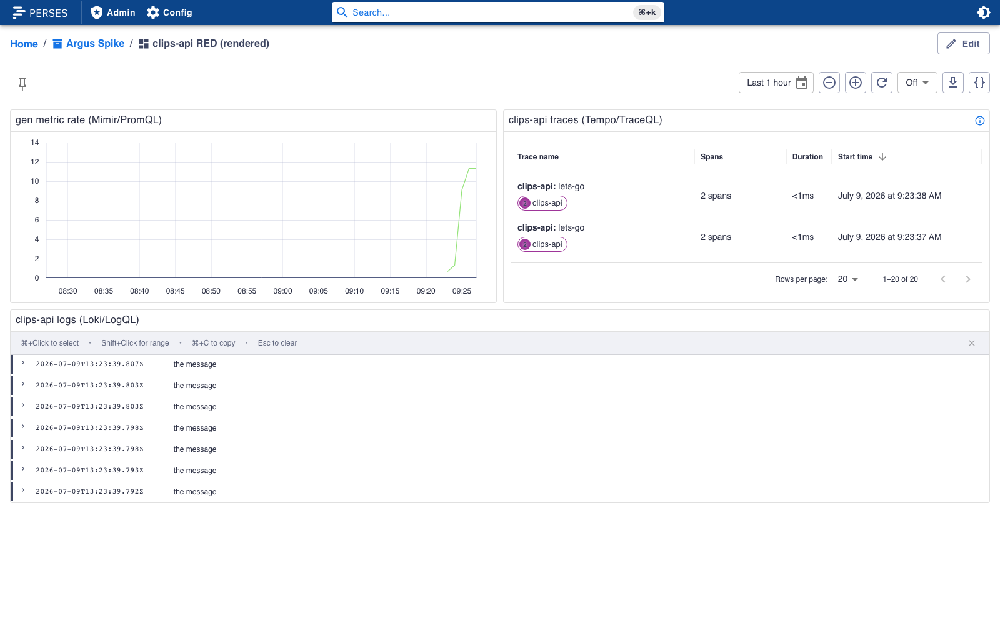

# Spike 0001: Perses capability vs Mimir/Loki/Tempo

> **Status:** PASS - Perses stands. Run 2026-07-09 on kind, closes issue #11.
> **What was tested:** Perses 0.53.1 against Mimir 3.1.1, Loki 3.7.2, Tempo 2.10.7 (pinned images,
> monolithic single-process for the spike), synthetic OTLP telemetry via telemetrygen v0.154.0 at
> rates matching the first deployment's measured fleet volume. Manifests in this directory
> reproduce it: `backends.yaml`, `perses.yaml`, `telemetrygen.yaml`.

## Verdict

Perses 0.53.1 covers all three signals against our backends, provisioned 100% declaratively via
API. The Grafana fallback is NOT invoked. One item stays open (exemplar click-through, below) as a
Phase 1 content-work check, not a fallback trigger.

## What passed

| Check | Result |
|---|---|
| Plugin coverage | Ships Loki (datasource + LogQuery + LogsTable), Tempo (datasource + TraceQL + Gantt/TraceTable), full Prometheus suite - plus ClickHouse and Pyroscope datasources |
| Dashboards-as-code | Project, 3 datasources, and a mixed-signal dashboard (PromQL + LogQL + TraceQL panels) created via plain API POSTs, zero UI authoring |
| PromQL through Perses proxy | `sum(rate(gen[5m]))` returns series from Mimir |
| LogQL through Perses proxy | `{service_name="clips-api"}` returns log lines from Loki (OTLP-ingested, structured metadata) |
| TraceQL through Perses proxy | `{resource.service.name="clips-api"}` returns traces; single-trace fetch (the Gantt data path) returns full trace |
| Span metrics / service graph | Tempo metrics-generator remote_writes into Mimir; `traces_spanmetrics_calls_total` queryable by service |
| Tenancy | `HTTPProxy` datasource spec accepts custom headers (`X-Scope-OrgID`) - the tenant-per-cluster model works per datasource |
| UI render | Screenshot (`perses-dashboard.png`): all three panels display real data |
| Exemplars API | Mimir `query_exemplars` reachable through the Perses proxy (0 series - telemetrygen attaches no exemplars) |

## Open item (not a fallback trigger)

**Exemplar rendering / cross-signal click-through at the UI level is unverified.** The server-side
API path works, but telemetrygen emits no exemplars, and Perses's TimeSeriesChart exemplar UI
support is unconfirmed. Verify during Phase 1 content work with a real OTel SDK app emitting
exemplars; until then, default dashboards mitigate by co-locating correlated panels (metric + trace
+ log for the same service on one dashboard), which the spike proved works. If the click-through
matters operationally and Perses cannot do it, that is when the fallback conversation reopens -
with data.

### Addendum (2026-07-13, issue #47): verified with a real exemplar-emitting app

The open item is now answered, live, in two halves:

**Noto's pipeline carries exemplars end to end.** A pinned OTel Python SDK app
([tests/smoke/exemplar-app.yaml](../../../tests/smoke/exemplar-app.yaml); trace_based exemplar
filter, the SDK default) shipped OTLP through agent -> gateway -> Mimir (exemplar storage enabled
in [helm/values/mimir.yaml](../../../helm/values/mimir.yaml), `max_global_exemplars_per_user`).
`query_exemplars` through the Perses **mimir datasource proxy** returned exemplars carrying
`trace_id`/`span_id`, and fetching that exact trace through the **tempo datasource proxy**
returned the full trace - every byte a UI click-through needs is served by our stack, through
Perses's own proxy paths. The smoke DoD now asserts this permanently (8th assertion).

**Perses 0.53.1 cannot render them.** A TimeSeriesChart panel over the exemplar-bearing metric
renders the series but no exemplar markers ([exemplar-check.png](exemplar-check.png)), and the
frontend has no code path for it: all 83 loaded JS assets contain zero occurrences of "exemplar"
(scanned via Playwright against the live UI), and the upstream changelog through 0.54.0-beta.2
has never mentioned exemplars. Not a hidden toggle - an absent feature.

**Standing answer:** co-located correlated panels remain the documented mitigation. Revisit
trigger: a Perses release notes exemplar support in TimeSeriesChart; Noto's backend is already
exemplar-ready, so adoption is then a UI-version bump, not a pipeline change.

## Operational gotchas learned (feed into Helm values / renderers)

1. **Never mount config over `/etc/perses`** - it masks the image's bundled plugin archives and
   Perses starts with zero plugins (empty `/api/v1/plugins`). Mount config elsewhere
   (`/perses-config` here). This must be encoded in our Perses Helm values.
2. Loki 3.x OTLP ingest wants `limits_config.allow_structured_metadata: true` and an `otlp_config`
   resource-attribute index-label mapping (`service.name`, `k8s.namespace.name`,
   `k8s.cluster.name`) - otherwise labels are unqueryable. Belongs in our Loki values.
3. Mimir ingests OTLP natively at `/otlp/v1/metrics`; Loki at `/otlp/v1/logs`; Tempo at `:4317/4318`.
   No `prometheusremotewrite` translation needed anywhere in the happy path - worth reflecting in
   the ingest-tier exporter choices.
4. Mimir rejects out-of-order samples from concurrent identical series (telemetrygen with
   `--workers>1` on one metric name) - irrelevant for real apps, relevant for synthetic-load design
   in the smoke test.
5. Tempo's metrics-generator (`service-graphs`, `span-metrics` processors) gives Mimir the service
   graph with three lines of config - the spanmetrics connector in our collector distro and this
   overlap; decide one owner during distro work (leaning Tempo-side: fewer collector pipelines).
